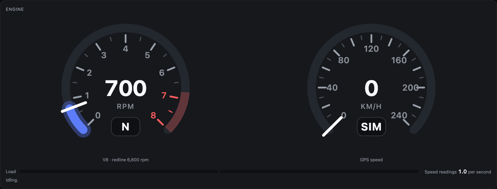
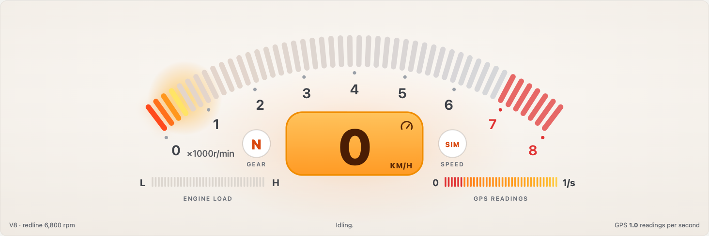
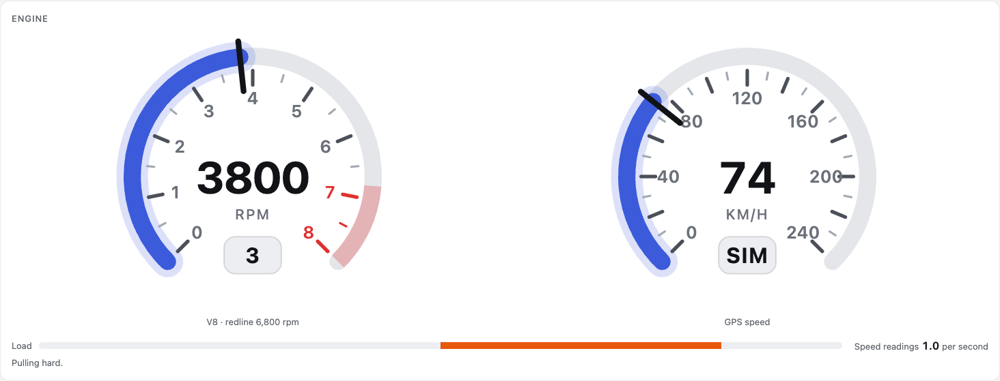
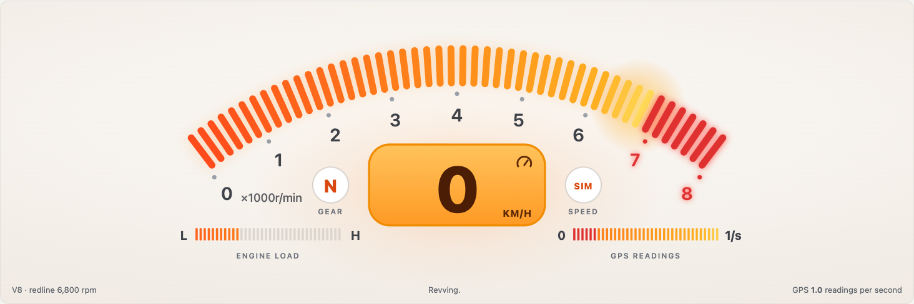
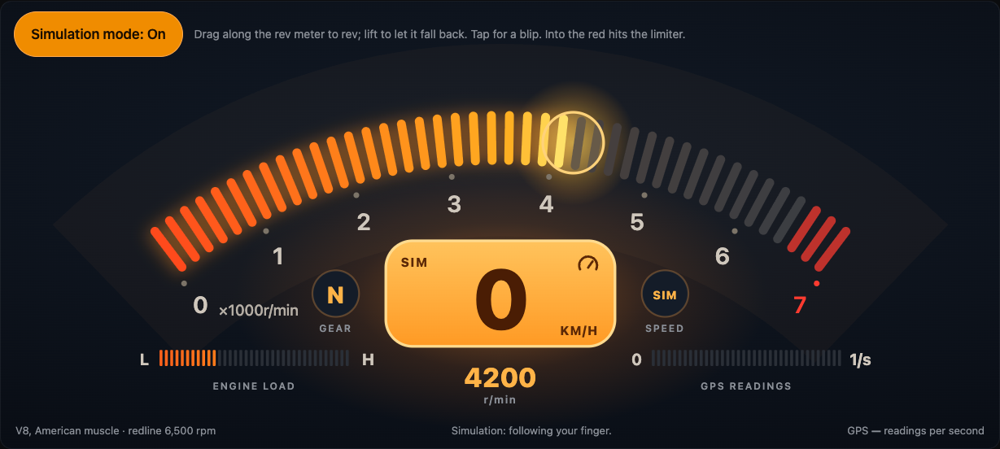
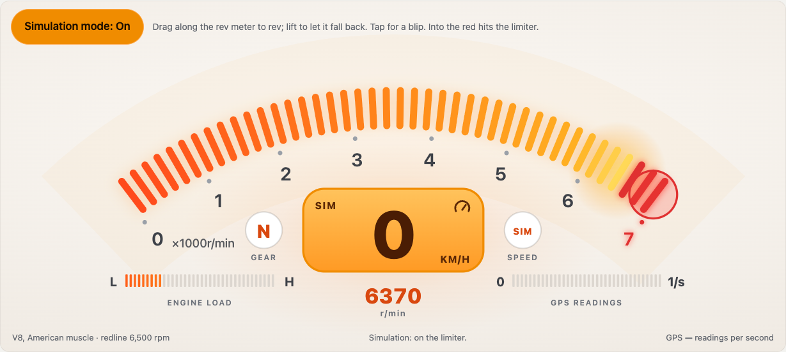
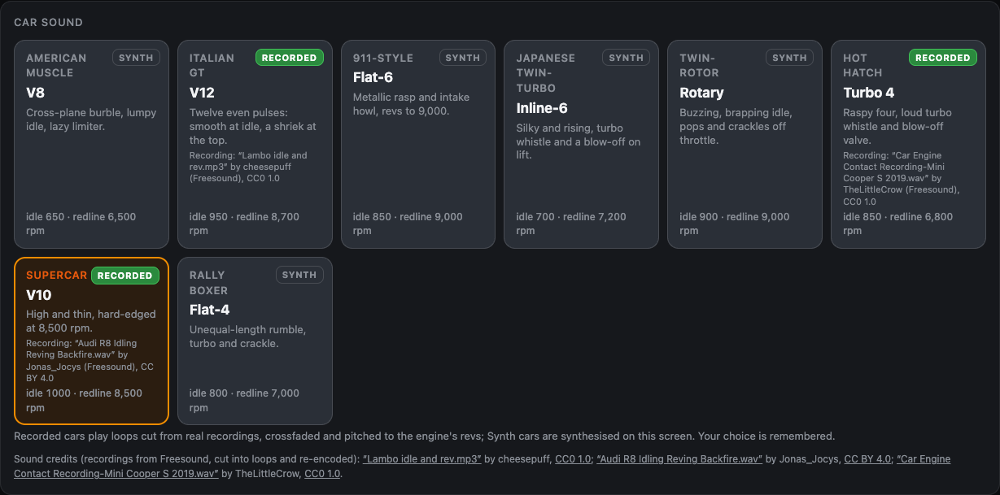
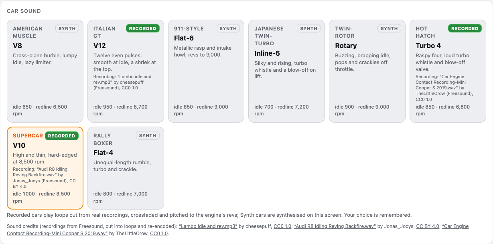

# Engine sound

Status: **built and tested off the car; never heard in the car.** Off by
default. Nothing on the Pi changes: the sound is made and played by the car's
browser, and the Pi only serves a few more static files.

A synthesised engine that revs and shifts as you drive, through the car's own
speakers. It is modelled on [TesRev](https://tesrev.com/). None of TesRev's
code or sounds are used: its site publishes no source code and no licence
for its sounds. Four cars are synthesised from numbers in
`static/rev-profiles.js`. Three play loops cut from freely licensed
recordings of real engines ([Recorded sounds](#recorded-sounds)). The V8
plays loops we render ourselves with engine-sim, a physically modelled
engine ([The engine-sim V8](#the-engine-sim-v8)). The synthesiser is the
fallback for all of them.

## 1. How TesRev works

Read from tesrev.com (home, `/about/`, `/guides/`, `/legal/`) on 2026-11-23.

| | TesRev |
|---|---|
| What | A web page that synthesises an engine (11 engines: V8, inline-6, V10, V12, flat-plane V8, rotary, a turbine…) that revs and shifts with your driving. Free while it is in testing, with no app and no account. |
| Where it plays | **Inside the car only.** Either the phone plays it over Bluetooth into the car, or the Tesla's own browser plays it. Its Boombox guide draws the line: "The Boombox plays sounds outside the car, when parked. TesRev plays an engine inside the car, while you drive." |
| What drives it | **Sensors only, "never through the car's systems".** It does not use the Fleet API, BLE, CAN or OBD. The phone's accelerometer gives acceleration and its GPS gives speed. With no phone, "the Tesla screen follows the Tesla's own GPS speed, a little later and less finely." It turns acceleration into engine load with "your Tesla model's mass, power and drag". |
| Latency | Phone over Bluetooth adds about 0.2 s. A phone relaying to the Tesla screen adds "a few hundredths of a second". Tesla GPS alone has no figure, only "a little later". There is a "Delay compensation" setting. |
| Gearbox | Comfort, Normal and Sport set where it shifts. A Rev button plays the engine while parked. |
| Legal | The driver stays responsible. Keep the volume low enough to "hear horns, sirens and other road users". The sound "does not reflect the car's real state or speed". Not affiliated with Tesla. |

TesRev's best mode needs a phone in a holder, sending its accelerometer to the
car's screen over the internet. Its fallback is the car's GPS speed alone.

## 2. What this Pi can know about the car, and how fast

From [`telemetry-options.md`](telemetry-options.md):

| Source | Gives | Rate | Usable for an engine? |
|---|---|---|---|
| Browser geolocation (the car's GPS) | speed, heading | about 1 Hz expected while moving. **The Drive run is still not done.** Parked it measured 0.1 Hz, because the car fires only on change. | **Yes.** This is the only real-time source we have. |
| BLE (`tesla-control`, monitor key) | `drive.speed`, `power`, `shiftState` | **~2.9 s per read**, and each read takes one of the car's **three** BLE slots | No. It is too slow, and the docs forbid polling it. |
| Fleet API / HA `tesla_fleet` | the same, from the cloud | ~10 min, and frozen while asleep | No. Cloud values freeze at their last reading while the car sleeps, and a stale speed is worse than none. |
| CAN (Tier 3) | real pedal position, torque, rpm | 10–100 Hz | It would be ideal, but it needs a harness, trim removal and a DBC to maintain. Not now. |
| `DeviceMotionEvent` in the car's browser | acceleration, if any | — | **Not measured.** No motion sensor is documented for the car's browser, and WebGPU and Web Bluetooth were both missing when measured ([`tesla-browser-capabilities.md`](tesla-browser-capabilities.md)). It would be worth one line in a probe page. |

The audio path is settled. The car's browser already plays Web Audio through
the cabin speakers: RetroArch's audio and CarPlay's "Browser" audio mode both do
it. The Pi has **no** audio path into the car of its own, which is why the
RetroArch addon captures its audio on the Pi and streams it to the browser.

## 3. What was chosen, and why

**Synthesis in the car's browser, driven by the car's GPS speed.** This is
TesRev's "Tesla only" mode.

- **The browser is where the speakers are.** Making the sound on the Pi would
  mean streaming PCM over the hotspot and adding a jitter buffer, so the
  latency would get worse, not better. It would also put audio work on the
  CPU that CarPlay needs.
- **Synthesis first, recordings where they exist.** A synthesised engine is a
  few kB of numbers, its pitch is exact at every rpm, and load changes its
  timbre rather than just its volume. Recordings sound real but need steady
  stretches at several rpm, under a licence we may ship. Three cars have
  them ([Recorded sounds](#recorded-sounds)), and the V8 has loops rendered
  with engine-sim ([The engine-sim V8](#the-engine-sim-v8)); the rest stay
  synthesised.
- **GPS speed with a physics load model.** Speed is the one signal we have in
  real time. Load comes from how fast it changes, the way TesRev uses mass,
  power and drag: (mass × accel + drag + rolling) ÷ the force available at
  that speed. Negative load is overrun.
- **Nothing on the Pi.** `index.js` is untouched. A bug here cannot hurt CarPlay,
  the hotspot or the cert service. The worst case is a silent page.

### The cost: the engine lags the pedal

With fixes about once a second, the engine hears about a pull **0.5–1.5 s
after the pedal**. A launch from rest is the worst case, because the first
non-zero speed is what tells the engine the car is moving. Between fixes the
engine keeps going at the last acceleration, so a pull sounds continuous
rather than stepped. Acceleration is weighted toward the newest step, so a
lift-off is heard at the next fix. The demo renders and the simulator use a
1 Hz fix rate on purpose, so what you hear at a desk is what the car will do.

Ways to close the gap later, in order of effort:

1. **Measure the Drive fix rate.** Status → Car → This trip shows it. If the
   car does 5–10 Hz while moving, most of the lag goes away for free.
2. **Phone relay**, as TesRev does: a page on the iPhone sends
   `DeviceMotionEvent` to the car's page. The catch is that the iPhone is on the
   CarPlay dongle's Wi-Fi, not the Pi's hotspot, so it has no route to the Pi
   today.
3. **CAN**: real pedal position. This needs hardware (Tier 3).

## 4. How it is built

```
car GPS ─► SpeedTracker ─► v, a ─► loadFromMotion ─► load ─┐
 (or the simulator's pedal)   │                            ▼
                              └──────────────────────► Gearbox / FreeRev ─► rpm, gear, load
                                                                        │ 50 Hz, postMessage
                                                                        ▼
                                                  AudioWorklet: EngineVoice ─► car speakers
```

| File | What |
|---|---|
| `static/rev-model.js` | Pure model: `SpeedTracker` (fixes timed on arrival, never `pos.timestamp`, which the car does not keep as epoch time), `loadFromMotion`, `Gearbox` (a virtual automatic with load-dependent shift points, a kickdown, a short torque cut on upshift, and clutch slip at launch), `FreeRev` (parked revving with each engine's own bouncing limiter; in simulation mode it chases a finger instead of a throttle), and `SimCar`. |
| `static/rev-profiles.js` | Eight car sounds (see [The car sounds](#the-car-sounds)). Each one sets its firing pattern, pipe resonances, pulse width, induction, gearing, idle, redline, limiter, pop rate, lope and, for three of them, a turbo. |
| `static/rev-sampler.js` | The recorded-engine player, run inside the same AudioWorklet: keeps every loop of a car playing, pitches each to the engine's rpm (rpm ÷ the rpm it was recorded at, at most 3.2×), and crossfades the two either side with equal power. Load opens a tone filter and raises the level; it would pick on-load / off-load layers if a car had both. |
| `static/rev-samples.js` | Where every loop came from: the recording, its page, author, licence and fetch date, and the stretch each loop was cut from and its measured rpm. The page credits from it, the builder rebuilds from it, and the tests check it. |
| `static/sounds/` | The loops (Ogg Opus, mono; 28 files, about 305 kB together) and `CREDITS.md`. |
| `scripts/engine-sim/` | A headless build of engine-sim (MIT) for macOS and the scripts that render the V8's loops; see its README. Nothing in it ships to the Pi. |
| `scripts/rev-samples.mjs` | Rebuilds `static/sounds/` from the recordings: fetches each from the address in its credit, cuts, loops, levels and encodes. Needs `ffmpeg` and `curl` on the machine that builds; the car needs neither. |
| `static/rev-worklet.js` | The synthesiser, an AudioWorklet. Every cylinder fires once per 720° and sends an exhaust pulse into its bank's resonators. A load-dependent tone filter, induction noise, overrun pops, an idle lope, saturation and a DC blocker follow; a turbo adds a whistle that rises with boost and a blow-off hiss on lift-off. It allocates nothing on the audio thread. |
| `static/rev-sound.js` | The controller: AudioContext, worklet, GPS watch, 50 Hz tick, settings (in `localStorage`), and pause when the tab is hidden. |
| `static/rev.html` | The page for the dashboard, **Simulation mode**, the car sound picker, settings and the Test drive: `https://<device>/rev.html`. Follows the car's day/night theme. |
| `static/rev-gauge.js` | The cluster on `rev.html`, plain SVG with no library. Its layout follows a reference dashboard the owner chose. **Tachometer:** a wide arc of segments, scaled to the chosen engine, with numbers and dots underneath. Lit segments warm from deep orange to yellow at the current revs, with a soft bloom and a glow riding the tip. Unlit ones are dim brown fading to grey, and the redline segments are always red. At the limiter the red zone lights and glows like a shift light; the red latches for 0.3 s, so the bounce reads steady. **Speed:** a glowing orange pill in km/h, showing the speed the engine follows. Beside it are the gear and the speed source (GPS, or SIM in the simulator). **Side bars:** engine load (L–H), and GPS readings per second (full at one per second, the car's expected rate). **Digits:** engine speed under the pill. In simulation mode the arc is also the control: a band about twice as deep as the segments takes a finger (`onArc`, `valueAt`). Everything eases toward each new reading on its own animation frame. |
| `static/index.html` | Settings → CarPlay → **Engine sound** (Experimental, off). When on, the main page loads the module and starts the engine at the first tap, so it plays under CarPlay. |
| `scripts/rev-render.mjs` | Renders a scene to WAV through the same code: `drive` (45 s), `rev` (simulation mode, 11 s) or `demo` (both, 22 s); `--all` does every car. |
| `test/rev-*.test.mjs` | 108 tests: recorded sounds (every loop file present, Ogg Opus, credited under CC0 or CC BY from its own Freesound page or MIT from the official engine-sim repo, listed in `CREDITS.md`, within the size budget, two or more rpm points per car; an engine-sim car has on-load and overrun loops at every rpm, overrun quieter; loops made seamless; the player's pitch, crossfade, layers, click-free sweep, pitch limit and silence); simulation mode (only when stopped, refused when the last reading was moving, ends when the car moves, the finger followed within ~0.1 s, the fall back to idle, blips, the limiter and its steady state); every car sound complete and distinct, turbo spool and blow-off, idle lope; the arc's touch mapping and hit band; cluster segments and red zone per engine, arc geometry, lit counts and colours, bars, easing, and the red at the limiter for every engine; tracker, load, gearbox (including no gear hunting), free rev, sim car, firing rate per engine, loudness under load, periodicity, pops only on overrun, determinism, settings. |

### Safety rails

- **Off by default.** The switch is in Settings → CarPlay, or "Play while
  driving" on `rev.html`.
- **Inside the car only.** It plays only through the browser's normal audio
  output. Nothing here touches the Boombox / external speaker, and nothing
  should. Pedestrian-warning sound rules are about the exterior, and this
  does not go there.
- **Rev works only when stopped** (below about 4 km/h). The model ignores it at
  speed, and the page greys it out.
- **No GPS, no engine.** A hidden tab stops the GPS watch and suspends the
  audio. If fixes stop, the engine settles rather than guessing.
- **Simulation mode is for a parked car.** See [Simulation mode](#simulation-mode).
- The volume control is squared, so the bottom half of its travel is quiet.
  The page says to keep it low enough to hear horns and sirens.

### Simulation mode

A toggle above the dashboard, **Simulation mode**, turns the rev arc into a
control (`rev.html` is the only page with the dashboard; the main page has
just the on/off switch):

- **Drag** along the arc and the engine follows the finger. It is within 5 %
  of the finger in about 0.1 s: a 40 ms glide in the model, so a jump across
  the arc never clicks, and the gauge eases at 30 ms instead of 80 ms while
  in this mode. The lit segments, the rpm digits and the sound all follow.
- **Lift** and the revs fall back to idle at the engine's own rate, on
  overrun, so it crackles on the way down like a real one.
- **Tap** (under 250 ms, barely moving) for a blip: the engine still reaches
  the tapped rpm, then falls.
- **Into the red** asks for past the redline, so it hits that engine's
  limiter and bounces off it: a hard 45 ms cut on the flat-6, a lazy 110 ms
  one on the V8. The red zone lights and glows, the state line says "on the
  limiter", and the cuts are overrun, so it pops.
- The finger can grab anywhere in a band from just above the speed pill to
  above the arc, a little past each end. The page sets `touch-action: none`
  on it only in this mode, so it never steals a scroll otherwise.

**Speed while simulating.** The pill reads the car's real speed, which is 0,
because simulation mode only runs stopped, with a **SIM** tag in the pill
and SIM in the source chip; the gear reads **N**. Revving a parked car in
neutral is what this is, so the speedometer should not pretend the car is
moving. (Deriving a speed from the rpm and a gear would show a moving car
on a parked one.)

**Safety: stopped only.** `Engine.setSim()` refuses to start while the car is
moving, and `Engine.step()` ends it on the first tick the car is:

- "Stopped" is the same test the Rev button uses: the speed estimate is
  under `STOPPED_MS` (1 m/s, ~4 km/h), or the car has not reported a speed
  at all yet.
- A car whose fixes **stopped coming while it was moving** counts as moving,
  so a lost GPS signal never re-enables it.
- When it ends, the finger is let go of, the engine goes back to following
  the car's GPS, the toggle turns off and is greyed out while the car moves,
  and the page says why. In the Test drive the car ended it 0.7 s after
  pulling away; on the car's GPS it is the first fix over ~4 km/h, so up to
  about a second.

### The car sounds

A card picker on `rev.html`. Tapping a card switches the sound, rescales the
rev arc to that engine's redline, plays a blip (stopped only) so you hear
it, and remembers the choice in `localStorage` (the same `revSound` key, so
the main page uses it too). Each card says **Recorded** or **Synth**. No new
dependencies. Names describe a style of engine, never a brand.

| Card | Idle / redline | Character |
|---|---|---|
| V8, American muscle | 650 / 6,500 | Cross-plane firing order into two banks, so it burbles; a big-cam lope at idle; a lazy 110 ms limiter. |
| V12, Italian GT | 950 / 8,700 | Twelve even pulses alternating banks: smooth at idle, a high shriek at the top. |
| Flat-6, 911-style | 850 / 9,000 | Alternating banks, short hard pipes and a loud intake howl; a hard 45 ms limiter. |
| Inline-6, Japanese twin-turbo | 700 / 7,200 | Even and silky, with a turbo whistle and a blow-off on lift. |
| Rotary, twin-rotor | 900 / 9,000 | Four short, sharp pulses per cycle through one pipe and a lot of drive, so it buzzes; a strong lope ("brap") at idle and the most pops. |
| Turbo 4, hot hatch | 850 / 6,800 | A raspy four with the loudest whistle and blow-off. |
| V10, supercar | 1,000 / 8,500 | Even-fire, high and thin. |
| Flat-4, rally boxer | 800 / 7,000 | Unequal-length headers pair the pulses into a rumble; a mild turbo and crackle. |

Turbo: boost builds with load and revs over the engine's spool time and
bleeds off in ~0.25 s. The whistle rises in pitch with boost, and lifting
with boost up fires the blow-off. Lope is a random spread in firing
strength, with an occasional near-miss, that fades out by three times idle.

### Recorded sounds

The owner asked whether the sounds could come from TesRev or other engine
sound projects. Not TesRev's: they are its own and come with no licence to
reuse. But real recordings under a licence that allows reuse in this public
repository can, and three cars now use them.

**The bar.** A recording is used only if all of these hold:

- the person who uploaded it recorded it themselves;
- it is CC0 or CC BY (never NC, ND, Sampling+ or unclear, never from a game,
  app, video or commercial product);
- its page or tags identify the engine, or its harmonics do;
- it has steady stretches at **two or more rpm** of one engine: idle alone
  cannot be pitched convincingly across a rev range;
- the engine is not buried under crowds, other engines or wind.

**Where the files come from.** Freesound's own page for each sound. Without a
login Freesound serves a 128 kbit/s MP3 preview of every sound (the original
file needs an account), and that preview is what was fetched, on 2026-11-23,
from the address recorded in each credit. `scripts/rev-samples.mjs` fetches
from exactly those addresses and nothing else.

| Car | Recording | Author | Licence | Loops (rpm) |
|---|---|---|---|---|
| V12, Italian GT | [Lambo idle and rev.mp3](https://freesound.org/people/cheesepuff/sounds/112075/): a Murciélago LP 670-4 SuperVeloce at a dealer | cheesepuff | CC0 1.0 | 1,184 (fast idle), 2,904 |
| Turbo 4, hot hatch | [Car Engine Contact Recording-Mini Cooper S 2019.wav](https://freesound.org/people/TheLittleCrow/sounds/669618/): contact mics on the engine block, driven in sport mode | TheLittleCrow | CC0 1.0 | 900, 2,988, 3,744, 4,842, 5,541 |
| V10, supercar | [Audi R8 Idling Reving Backfire.wav](https://freesound.org/people/Jonas_Jocys/sounds/457733/): idle and holds at several rpm | Jonas_Jocys | **CC BY 4.0** | 806, 1,930, 2,777, 4,070 |

The CC BY recording is credited on its card in the picker, in the credits
line under it, and in `static/sounds/CREDITS.md`.

**How each loop was cut.** Each recording's spectrum was read at high
resolution (2.7 Hz per bin) to find stretches where the engine holds a speed
within a few percent. Its rpm comes from the spacing of its harmonics and
the engine's firing order: the 3rd order (one bank) of the V12, the 2nd
order (the firing rate) of the four, and the 2.5th order (one bank) of the
V10. The R8 page does not say whether it is the V8 or the V10. In every hold,
the strongest lines are the 2.5th and 5th orders, the pattern of a V10 (a V8
fires on the 4th), so it is filed as the V10. Each stretch is made to loop by
crossfading its end into its start, levelled (louder with revs), and padded
with 20 ms of its own wrap-around so the codec's edges never fall in the
seam. Every seam was checked after encoding: no step at a seam is larger
than the loop's largest ordinary step.

**How it plays.** The player follows the same rpm as the synthesiser (GPS,
Test drive or the finger). Between two recorded rpm points it crossfades;
past the last one it pitches the top loop up, at most 3.2×. The V12's top
loop is 2,904 rpm, so its top end is the most stretched. All loops are
"under load or idle" (single layer): none of the recordings has a long enough
lift-off at a steady rpm for an off-load layer. **Recorded sounds** in the
Sound card switches every car back to the synthesiser; if the files cannot
be loaded, the synthesiser plays and the page says so.

**What was rejected, and why.**

| Source | Why not |
|---|---|
| TesRev | Its own sounds, published with no licence to reuse. |
| [engine-sim](https://github.com/ange-yaghi/engine-sim) (MIT) | Its `sound-library` holds impulse responses for its convolution stage, not recordings of engines. |
| OpenGameArt engine loops | "Racing car engine sound loops" has its licence questioned in its own comments; the CC0 alternatives are synthesised or made with a mouth. |
| Freesound, Sampling+ (a retired licence, not CC0 or CC BY) | djbono's Ferrari 456 V12 and Porsche 911T, Fuser10's rotary engine. |
| Freesound, NC | FritzSounds' Porsche 911 GT3 Cup (CC BY-NC). |
| Freesound, licence fine, recording not | Hot-rod V8 at Summernats (Ears68, CC BY 3.0): festival ambience, other engines running under it. Parade of open-header V8s (holderall, CC0): several cars and a crowd. "Classic Car Idle", a 350 Rocket V8 (jackthemurray, CC0): idle only. Ford 460 V8 (Henaway, CC0): one 3.7 s blip. Subaru WRX (ulose2piranha, CC0): a clean idle, but the revs are blips with no hold. VW Golf GTI (EverydaySounds, CC0): drive-aways past the mic. BMW M6 (Kinoton, CC0): a V10 or V8, not an inline-6, and driving away. The Murciélago's 5 s clip (cheesepuff, CC0): one blip. Lamborghini start-up (florianreichelt, CC0), "Porsche idle" (victormalloy, CC0), "Supercar rev" (richwise, CC0), Lotus (wikusv, CC BY 4.0): the engine is not identified. 2012 Civic (thepodcastdoctor, CC0): not turbocharged. Drag cars (lonemonk, CC BY 4.0): several cars at once. |

**Cars with no usable recording:** **V8** (no recording of one V8 with
steady stretches at two rpm; it now uses engine-sim, below), **Flat-6** (the
911 recordings are Sampling+ or NC), **Inline-6** (none found), **Rotary**
(the only rotary is Sampling+) and **Flat-4** (the WRX has only its idle
steady). The bar was not lowered for them.

### The engine-sim V8

**Why.** The owner heard the first version in the car and found it fake. The
likely causes (in `docs/rev-sound-sources.md`, with the other options):

- The recorded cars have too few rev points stretched too far: the V12 plays
  at 3.0× near its redline, the V10 at 2.1×.
- No car had a lift-off sound.
- The synthesiser is a simple pulse-and-resonator model.

**What.** [engine-sim](https://github.com/ange-yaghi/engine-sim) (MIT)
simulates a combustion engine and produces its audio. We render its bundled
GM LS V8 offline:

- a free-running idle (about 700 rpm);
- 8 rev points from 1,200 to 6,300 rpm, each held on engine-sim's dynamometer
  twice: at **full throttle (on-load)** and at **closed throttle (overrun)**.

Those 17 renders are cut into loops by the same builder as the recordings
(`scripts/rev-samples.mjs`), at 64 kbit/s, 199 kB. In the player:

- **Load picks the layer.** Pulling plays the on-load loops. Lifting off, or
  the revs falling after a blip, crossfades into the overrun loops, which
  are quieter and sound different.
- **Small stretches.** The nearest loop is never stretched more than 1.31×
  (just above idle), and about 1.2× elsewhere.
- **Levels.** Each loop keeps the engine's own level relative to the
  loudest on-load loop, square-rooted so overrun and idle stay audible.

The V8's card says **engine-sim**; "Recorded sounds" off returns it to the
synthesiser. The renders are our own output, and engine-sim is credited on
the card and in `CREDITS.md`.

**How it was built.** engine-sim officially builds only on Windows. Its
simulation core builds headless on macOS after six small portability
patches. `scripts/engine-sim/README.md` lists them and has the commands to
rebuild, re-render and add other engines. engine-sim bundles a V10, two
inline-6s, a flat-4 and two V12s, but no flat-6 or rotary. A fresh build and
render reproduces the committed loops' renders exactly.

### The cluster

| | Idle | Mid-rev | At the limiter |
|---|---|---|---|
| Night |  |  |  |
| Day |  |  |  |

These were taken in the Test drive at 1 GPS reading a second, V8 profile, in
headless Chromium.

| | Simulation mode, mid-drag | Simulation mode, on the limiter |
|---|---|---|
| Night |  |  |
| Day |  |  |

The car picker, night and day:




## 5. Try it

At a desk, with no car and no Pi:

```bash
npm test                                         # 108 tests
node scripts/rev-render.mjs --profile v8         # writes rev-v8.wav, then: open rev-v8.wav
node scripts/rev-render.mjs --profile flat4 --mode sport --fix-ms 100
node scripts/rev-render.mjs --all --scene demo --out-dir rev-demos   # 22 s of every car
node scripts/rev-render.mjs --all --scene demo --recorded --out-dir rev-demos  # the recorded ones
node scripts/rev-samples.mjs                     # rebuild static/sounds/ (needs ffmpeg)
python3 -m http.server 8000 -d static            # then open http://localhost:8000/rev.html
```

On `rev.html`, turn on **Simulation mode** and drag along the rev arc, or
pick a car card to hear a blip. For driving, pick **Test drive**, press
**Start**, then hold **Accelerator** and **Brake**; "Speed readings" sets the
simulated GPS rate, and pulling away ends simulation mode just as the car
would. **Rev** blips the engine while stopped. `localhost` counts as a secure context, so the AudioWorklet loads
just as it does on the car's HTTPS page.

In the car (after deployment): open `https://<device>/rev.html`, choose **Car
GPS**, and turn on **Play while driving**. Or open Settings → CarPlay → Engine
sound on the main page.

## 6. Not yet known, and how to find out

1. **Whether browser audio mixes with Bluetooth music or takes it over.** If
   the car treats the browser as a media source, starting the engine could
   pause Spotify on the phone. RetroArch never had to answer this. Test it
   parked: play music over Bluetooth, then press Rev on `rev.html`.
2. **The GPS fix rate in Drive.** This sets the lag (§3). Read it from Status →
   Car → This trip, or from the "speed readings per second" gauge on
   `rev.html`.
3. **Whether the car's browser keeps playing** when the screen shows the map
   full-screen or another app. `visibilitychange` would pause it, which is the
   right behaviour, but it means no engine unless the browser is on screen.
4. **The recordings in the cabin.** Their seams, pitch tracking and levels
   were measured, not heard. The Mini's is a contact recording of the
   engine block, not the exhaust, and the V12 was recorded in a showroom on
   a phone's video; both may sound less like an exhaust than expected.
   The originals (behind a Freesound login) would be better than the
   previews.
5. **Dragging on the car's screen.** Pointer events in the desktop browser
   follow the finger within about 0.1 s. Whether the car's touchscreen
   delivers moves as smoothly is unmeasured.
6. **The sound itself.** The eight engines were tuned by numbers and offline
   renders, not by ear in a cabin. The car's speakers and EQ will change them.
   The profiles are plain data, so tuning them is easy.
