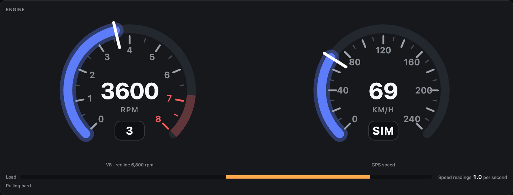
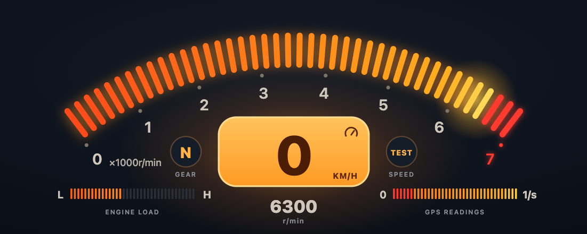
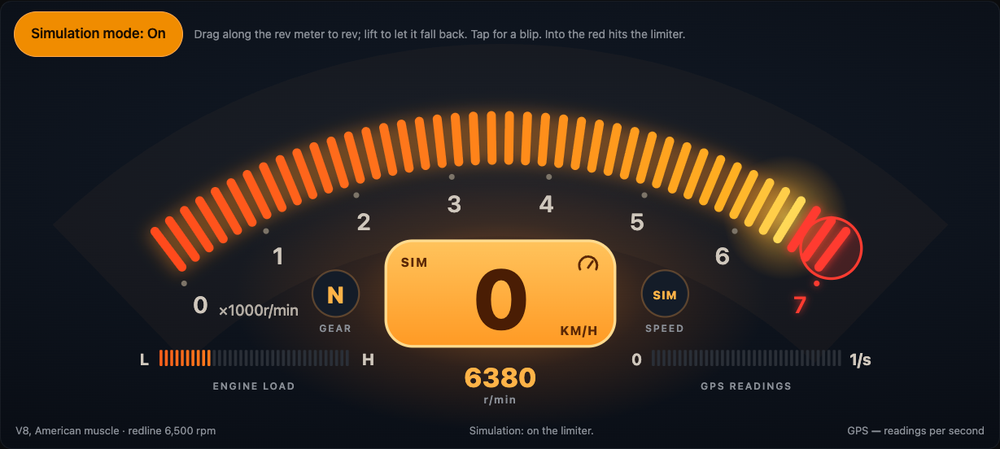
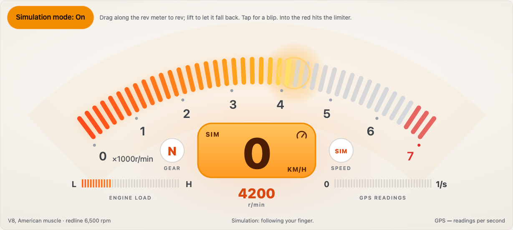

# Engine sound

Status: **built and tested off the car; never heard in the car.** Off by
default. Nothing on the Pi changes: the sound is made and played by the car's
browser, and the Pi only serves a few more static files.

A synthesised engine that revs and shifts as you drive, through the car's own
speakers. It is modelled on [TesRev](https://tesrev.com/). None of TesRev's
code or sounds are used: its site publishes no source code and no licence
for its sounds. There is one car, a V8, and its sound is loops we render
ourselves with engine-sim, a physically modelled engine
([The sound](#the-sound-an-engine-sim-v8)). A synthesiser stands in only
if the loops cannot be loaded.

## 1. How TesRev works

Read from tesrev.com (home, `/about/`, `/guides/`, `/legal/`) on 2026-11-23.

| | TesRev |
|---|---|
| What | A web page that synthesises an engine (11 engines: V8, inline-6, V10, V12, flat-plane V8, rotary, a turbine…) that revs and shifts with your driving. Free while it is in testing, with no app and no account. |
| Where it plays | **Inside the car only.** Either the phone plays it over Bluetooth into the car, or the Tesla's own browser plays it. Its Boombox guide draws the line: "The Boombox plays sounds outside the car, when parked. TesRev plays an engine inside the car, while you drive." |
| What drives it | **Sensors only, "never through the car's systems".** It does not use the Fleet API, BLE, CAN or OBD. The phone's accelerometer gives acceleration and its GPS gives speed. With no phone, "the Tesla screen follows the Tesla's own GPS speed, a little later and less finely." It turns acceleration into engine load with "your Tesla model's mass, power and drag". |
| Latency | Phone over Bluetooth adds about 0.2 s. A phone relaying to the Tesla screen adds "a few hundredths of a second". Tesla GPS alone has no figure, only "a little later". There is a "Delay compensation" setting. |
| Gearbox | Comfort, Normal and Sport set where it shifts. A Rev button plays the engine while parked. |
| Legal | The driver stays responsible. Keep the volume low enough to "hear horns, sirens and other road users". The sound "does not reflect the car's real state or speed". Not affiliated with Tesla. |

TesRev's best mode needs a phone in a holder, sending its accelerometer to the
car's screen over the internet. Its fallback is the car's GPS speed alone.

## 2. What this Pi can know about the car, and how fast

From [`telemetry-options.md`](telemetry-options.md):

| Source | Gives | Rate | Usable for an engine? |
|---|---|---|---|
| Browser geolocation (the car's GPS) | speed, heading | about 1 Hz expected while moving. **The Drive run is still not done.** Parked it measured 0.1 Hz, because the car fires only on change. | **Yes.** This is the only real-time source we have. |
| BLE (`tesla-control`, monitor key) | `drive.speed`, `power`, `shiftState` | **~2.9 s per read**, and each read takes one of the car's **three** BLE slots | No. It is too slow, and the docs forbid polling it. |
| Fleet API / HA `tesla_fleet` | the same, from the cloud | ~10 min, and frozen while asleep | No. Cloud values freeze at their last reading while the car sleeps, and a stale speed is worse than none. |
| CAN (Tier 3) | real pedal position, torque, rpm | 10–100 Hz | It would be ideal, but it needs a harness, trim removal and a DBC to maintain. Not now. |
| `DeviceMotionEvent` in the car's browser | acceleration, if any | — | **Not measured.** No motion sensor is documented for the car's browser, and WebGPU and Web Bluetooth were both missing when measured ([`tesla-browser-capabilities.md`](tesla-browser-capabilities.md)). It would be worth one line in a probe page. |

The audio path is settled. The car's browser already plays Web Audio through
the cabin speakers: RetroArch's audio and CarPlay's "Browser" audio mode both do
it. The Pi has **no** audio path into the car of its own, which is why the
RetroArch addon captures its audio on the Pi and streams it to the browser.

## 3. What was chosen, and why

**Synthesis in the car's browser, driven by the car's GPS speed.** This is
TesRev's "Tesla only" mode.

- **The browser is where the speakers are.** Making the sound on the Pi would
  mean streaming PCM over the hotspot and adding a jitter buffer, so the
  latency would get worse, not better. It would also put audio work on the
  CPU that CarPlay needs.
- **Rendered loops, not live synthesis.** The first version synthesised
  eight engines live and added a few Freesound recordings; in the car both
  sounded fake. A physically modelled engine (engine-sim) rendered offline
  into loops at many rpm, on-load and overrun, sounds far more like an
  engine and costs the car nothing but playback
  ([The sound](#the-sound-an-engine-sim-v8)).
- **GPS speed with a physics load model.** Speed is the one signal we have in
  real time. Load comes from how fast it changes, the way TesRev uses mass,
  power and drag: (mass × accel + drag + rolling) ÷ the force available at
  that speed. Negative load is overrun.
- **Nothing on the Pi.** `index.js` is untouched. A bug here cannot hurt CarPlay,
  the hotspot or the cert service. The worst case is a silent page.

### The cost: the engine lags the pedal

With fixes about once a second, the engine hears about a pull **0.5–1.5 s
after the pedal**. A launch from rest is the worst case, because the first
non-zero speed is what tells the engine the car is moving. Between fixes the
engine keeps going at the last acceleration, so a pull sounds continuous
rather than stepped. Acceleration is weighted toward the newest step, so a
lift-off is heard at the next fix. The demo renders and the simulator use a
1 Hz fix rate on purpose, so what you hear at a desk is what the car will do.

Ways to close the gap later, in order of effort:

1. **Measure the Drive fix rate.** Status → Car → This trip shows it. If the
   car does 5–10 Hz while moving, most of the lag goes away for free.
2. **Phone relay**, as TesRev does: a page on the iPhone sends
   `DeviceMotionEvent` to the car's page. The catch is that the iPhone is on the
   CarPlay dongle's Wi-Fi, not the Pi's hotspot, so it has no route to the Pi
   today.
3. **CAN**: real pedal position. This needs hardware (Tier 3).

## 4. How it is built

```
car GPS ─► SpeedTracker ─► v, a ─► loadFromMotion ─► load ─┐
 (or the simulator's pedal)   │                            ▼
                              └──────────────────────► Gearbox / FreeRev ─► rpm, gear, load
                                                                        │ 50 Hz, postMessage
                                                                        ▼
                                                  AudioWorklet: EngineVoice ─► car speakers
```

| File | What |
|---|---|
| `static/rev-model.js` | Pure model: `SpeedTracker` (fixes timed on arrival, never `pos.timestamp`, which the car does not keep as epoch time), `loadFromMotion`, `Gearbox` (a virtual automatic with load-dependent shift points, a kickdown, a short torque cut on upshift, and clutch slip at launch), `FreeRev` (parked revving with each engine's own bouncing limiter; in simulation mode it chases a finger instead of a throttle), and `SimCar`. |
| `static/rev-profiles.js` | The V8: idle, redline, gearing and limiter for the model, and the numbers the fallback synthesiser uses (firing pattern, pipe resonances, pulse width, induction, pop rate, lope). |
| `static/rev-sampler.js` | The loop player, run inside the same AudioWorklet: keeps every loop playing, pitches each to the engine's rpm (rpm ÷ the rpm it was rendered at, at most 3.2×), crossfades the two either side with equal power, crossfades the on-load and overrun layers by load, and the engine and exhaust groups by the Exhaust setting. |
| `static/rev-samples.js` | Where every loop came from: engine-sim's credit, and for each loop its render, rpm, layer and level, plus the set's impulse response, EQ and sub layer. The page credits from it, the builder rebuilds from it, and the tests check it. |
| `static/sounds/` | The loops (Ogg Opus, mono, 64 kbit/s; 34 files, 455 kB together, engine and exhaust) and `CREDITS.md`. |
| `scripts/engine-sim/` | A headless build of engine-sim (MIT) for macOS and the scripts that render the V8's loops; see its README. Nothing in it ships to the Pi. |
| `scripts/rev-samples.mjs` | Rebuilds `static/sounds/` from the renders: cuts, loops, EQs, mixes the sub layer, levels and encodes (`--print-levels` gives the levels). It can also fetch credited Freesound recordings. Needs `ffmpeg` on the machine that builds; the car doesn't. |
| `static/rev-worklet.js` | The synthesiser, an AudioWorklet. Every cylinder fires once per 720° and sends an exhaust pulse into its bank's resonators. A load-dependent tone filter, induction noise, overrun pops, an idle lope, saturation and a DC blocker follow. It allocates nothing on the audio thread. It plays the loop player when the car's loops are loaded, and the synthesiser only as the fallback. |
| `static/rev-sound.js` | The controller: AudioContext, worklet, GPS watch, 50 Hz tick, settings (in `localStorage`), and pause when the tab is hidden. |
| `static/rev.html` | The page for the dashboard, **Simulation mode**, the car card, settings and the Test drive: `https://<device>/rev.html`. Follows the car's day/night theme. |
| `static/rev-gauge.js` | The cluster on `rev.html`, plain SVG with no library. Its layout follows a reference dashboard the owner chose. **Tachometer:** a wide arc of segments, scaled to the chosen engine, with numbers and dots underneath. Lit segments warm from deep orange to yellow at the current revs, with a soft bloom and a glow riding the tip. Unlit ones are dim brown fading to grey, and the redline segments are always red. At the limiter the red zone lights and glows like a shift light; the red latches for 0.3 s, so the bounce reads steady. **Speed:** a glowing orange pill in km/h, showing the speed the engine follows. Beside it are the gear and the speed source (GPS, or SIM in the simulator). **Side bars:** engine load (L–H), and GPS readings per second (full at one per second, the car's expected rate). **Digits:** engine speed under the pill. In simulation mode the arc is also the control: a band about twice as deep as the segments takes a finger (`onArc`, `valueAt`). Everything eases toward each new reading on its own animation frame. |
| `static/index.html` | Settings → CarPlay → **Engine sound** (Experimental, off). When on, the main page loads the module and starts the engine at the first tap, so it plays under CarPlay. |
| `scripts/rev-render.mjs` | Renders a scene to WAV through the same code: `drive` (45 s), `rev` (simulation mode, 11 s) or `demo` (both, 22 s); `--recorded` plays the engine-sim loops instead of the synthesiser. |
| `test/rev-*.test.mjs` | 72 tests: the loops (every file present, Ogg Opus, credited MIT from the official engine-sim repo, listed in `CREDITS.md`, within the size budget; on-load and overrun loops at every rpm, overrun quieter, close enough steps; loops made seamless; the player's pitch, crossfade, layers, click-free sweep, pitch limit and silence); simulation mode (only when stopped, refused when the last reading was moving, ends when the car moves, the finger followed within ~0.1 s, the fall back to idle, blips, the limiter and its steady state); every car sound complete and distinct, turbo spool and blow-off, idle lope; the arc's touch mapping and hit band; cluster segments and red zone, arc geometry, lit counts and colours, bars, easing, and the red at the limiter; tracker, load, gearbox (including no gear hunting), free rev, sim car; the fallback synthesiser's firing rate, loudness under load, periodicity, pops only on overrun, lope and determinism; settings (a removed car falls back to the V8). |

### Safety rails

- **Off by default.** The switch is in Settings → CarPlay, or "Play while
  driving" on `rev.html`.
- **Inside the car only.** It plays only through the browser's normal audio
  output. Nothing here touches the Boombox / external speaker, and nothing
  should. Pedestrian-warning sound rules are about the exterior, and this
  does not go there.
- **Rev works only when stopped** (below about 4 km/h). The model ignores it at
  speed, and the page greys it out.
- **No GPS, no engine.** A hidden tab stops the GPS watch and suspends the
  audio. If fixes stop, the engine settles rather than guessing.
- **Simulation mode is for a parked car.** See [Simulation mode](#simulation-mode).
- The volume control is squared, so the bottom half of its travel is quiet.
  The page says to keep it low enough to hear horns and sirens.

### Simulation mode

A toggle above the dashboard, **Simulation mode**, turns the rev arc into a
control (`rev.html` is the only page with the dashboard; the main page has
just the on/off switch):

- **Drag** along the arc and the engine follows the finger. It is within 5 %
  of the finger in about 0.1 s: a 40 ms glide in the model, so a jump across
  the arc never clicks, and the gauge eases at 30 ms instead of 80 ms while
  in this mode. The lit segments, the rpm digits and the sound all follow.
- **Lift** and the revs fall back to idle at the engine's own rate, on
  overrun, so it crackles on the way down like a real one.
- **Tap** (under 250 ms, barely moving) for a blip: the engine still reaches
  the tapped rpm, then falls.
- **Into the red** asks for past the redline, so it hits the V8's limiter and
  bounces off it with a lazy 110 ms cut. The red zone lights and glows, the
  state line says "on the limiter", and each cut is overrun, so it plays the
  overrun loops.
- The finger can grab anywhere in a band from just above the speed pill to
  above the arc, a little past each end. The page sets `touch-action: none`
  on it only in this mode, so it never steals a scroll otherwise.

**Speed while simulating.** The pill reads the car's real speed, which is 0,
because simulation mode only runs stopped, with a **SIM** tag in the pill
and SIM in the source chip; the gear reads **N**. Revving a parked car in
neutral is what this is, so the speedometer should not pretend the car is
moving. (Deriving a speed from the rpm and a gear would show a moving car
on a parked one.)

**Safety: stopped only.** `Engine.setSim()` refuses to start while the car is
moving, and `Engine.step()` ends it on the first tick the car is:

- "Stopped" is the same test the Rev button uses: the speed estimate is
  under `STOPPED_MS` (1 m/s, ~4 km/h), or the car has not reported a speed
  at all yet.
- A car whose fixes **stopped coming while it was moving** counts as moving,
  so a lost GPS signal never re-enables it.
- When it ends, the finger is let go of, the engine goes back to following
  the car's GPS, the toggle turns off and is greyed out while the car moves,
  and the page says why. In the Test drive the car ended it 0.7 s after
  pulling away; on the car's GPS it is the first fix over ~4 km/h, so up to
  about a second.

### The sound: an engine-sim V8

There is one car, the **V8, American muscle**. Its sound is loops rendered
offline with [engine-sim](https://github.com/ange-yaghi/engine-sim) (MIT), a
physically modelled combustion engine, from its bundled GM LS V8:

- a free-running idle (about 700 rpm);
- 8 rev points from 1,200 to 6,300 rpm, each held on engine-sim's dynamometer
  twice: at **full throttle (on-load)** and at **closed throttle (overrun)**.

Each run is heard from two places, which the **Exhaust** setting crossfades
(equal power, default half and half):

- **Engine** (`static/sounds/v8-es-*`): through engine-sim's "real engine"
  impulse response.
- **Exhaust** (`v8-ex-*`): through its "minimal muffling" response, a near
  straight pipe, raspier, with its weight at 160–320 Hz.

That makes 34 loops at 64 kbit/s, 455 kB.

**How it plays:**

- **Load picks the layer.** Pulling plays the on-load loops. Lifting off, or
  the revs falling after a blip, crossfades into the overrun loops, which are
  quieter and sound different.
- **Small stretches.** Between rev points the player crossfades with equal
  power. The nearest loop is never stretched more than 1.31× (just above
  idle), and about 1.2× elsewhere.
- **Levels.** Each loop keeps the engine's own level relative to the loudest
  on-load loop, square-rooted so overrun and idle stay audible.
- **Fallback.** The V8's numbers in `static/rev-profiles.js` drive its
  gearbox and rev range. They also synthesise it, but only while the loops
  load or if they cannot be loaded; the dash then says "synthesised
  (fallback)".

**The bass.** The owner found the first render thin. It was: the LS script's
exhaust impulse response, `smooth_39`, is centred on 320–640 Hz, and left
80–160 Hz about 23 dB down. Three changes fixed it:

1. **A fuller impulse response.** The V8 is rendered through engine-sim's
   "real engine" response (`archive/test_engine_14_eq_adjusted_16.wav`), which
   has its body at 80–160 Hz.
2. **A sub layer.** That response still strips the lowest octave, where the
   V8's idle firing note (about 47 Hz) lives. So the same runs are rendered
   dry too, and the dry render, low-passed at 100 Hz, is mixed under each loop
   at 0.7 × its level.
3. **EQ.** A +10 dB low shelf at 90 Hz and a −4 dB high shelf at 3.5 kHz.

Measured on the 22 s demo, as each band's share of the total:

| | 20–80 Hz | 80–160 Hz |
|---|---|---|
| idle, before | −11 dB | −5 dB |
| idle, after | **−8 dB** | **−2 dB** |
| pulling, before | −23 dB | −16 dB |
| pulling, after | **−10 dB** | **−4 dB** |

That's within a few dB of real V8 recordings, and nothing clips.
`static/rev-samples.js` records the impulse responses, EQ, sub layer and
levels; `scripts/rev-samples.mjs` applies them. The exhaust group has the
same EQ and sub layer, so turning the Exhaust setting up keeps the bass.

**How it was built.** engine-sim officially builds only on Windows. Its
simulation core builds headless on macOS after six small portability
patches. `scripts/engine-sim/README.md` lists them and has the commands to
rebuild, re-render and add engines. A fresh build and render reproduces the
renders exactly.

**What came before.** The first version had eight cars: seven synthesised
engines, three of them with Freesound recordings. The owner heard them in the
car and asked for them to be removed. `docs/rev-sound-sources.md` keeps why
they sounded fake, the recordings and what was rejected, and the other sources
for better sound.

### The cluster

| | Idle | Mid-rev | At the limiter |
|---|---|---|---|
| Night |  |  |  |
| Day |  |  |  |

These were taken in the Test drive at 1 GPS reading a second, V8 profile, in
headless Chromium.

| | Simulation mode, mid-drag | Simulation mode, on the limiter |
|---|---|---|
| Night |  |  |
| Day |  |  |

## 5. Try it

At a desk, with no car and no Pi:

```bash
npm test                                         # 72 tests
node scripts/rev-render.mjs --scene demo --recorded --out-dir rev-demos   # the V8, 22 s
node scripts/rev-render.mjs --mode sport --fix-ms 100   # the fallback synthesiser, driving
node scripts/rev-samples.mjs --car v8            # rebuild static/sounds/ (needs ffmpeg and the renders)
python3 -m http.server 8000 -d static            # then open http://localhost:8000/rev.html
```

On `rev.html`, turn on **Simulation mode** and drag along the rev arc, or
tap the V8 card to hear a blip. For driving, pick **Test drive**, press
**Start**, then hold **Accelerator** and **Brake**; "Speed readings" sets the
simulated GPS rate, and pulling away ends simulation mode just as the car
would. **Rev** blips the engine while stopped. `localhost` counts as a secure context, so the AudioWorklet loads
just as it does on the car's HTTPS page.

In the car (after deployment): open `https://<device>/rev.html`, choose **Car
GPS**, and turn on **Play while driving**. Or open Settings → CarPlay → Engine
sound on the main page.

## 6. Not yet known, and how to find out

1. **Whether browser audio mixes with Bluetooth music or takes it over.** If
   the car treats the browser as a media source, starting the engine could
   pause Spotify on the phone. RetroArch never had to answer this. Test it
   parked: play music over Bluetooth, then press Rev on `rev.html`.
2. **The GPS fix rate in Drive.** This sets the lag (§3). Read it from Status →
   Car → This trip, or from the "speed readings per second" gauge on
   `rev.html`.
3. **Whether the car's browser keeps playing** when the screen shows the map
   full-screen or another app. `visibilitychange` would pause it, which is the
   right behaviour, but it means no engine unless the browser is on screen.
4. **The bass in the cabin.** The low end was raised to within a few dB of
   real V8 recordings (measured, see [The sound](#the-sound-an-engine-sim-v8)),
   but the car's speakers and EQ decide what is heard.
5. **Dragging on the car's screen.** Pointer events in the desktop browser
   follow the finger within about 0.1 s. Whether the car's touchscreen
   delivers moves as smoothly is unmeasured.
6. **The sound itself.** The V8 is engine-sim's LS script, rendered and
   measured here, not tuned by ear in a cabin. Its levels, EQ and sub layer
   are plain data in `static/rev-samples.js`, so tuning them is easy.
