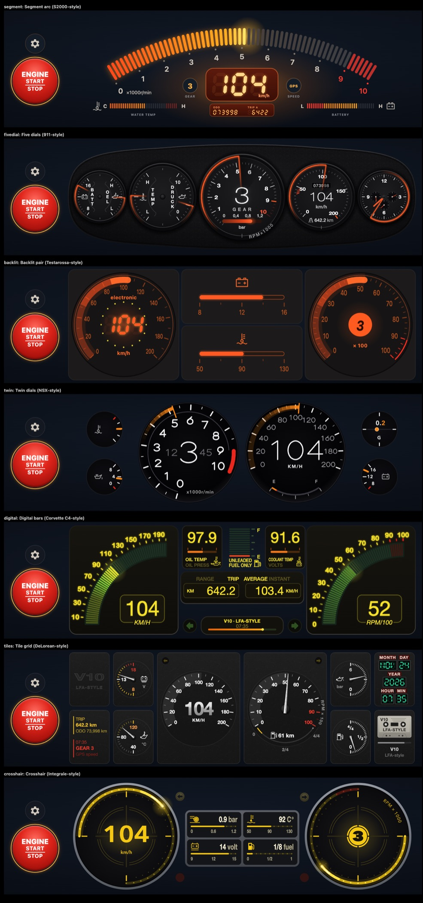

# Engine sound

Status: **built and tested off the car; never heard in the car.** Off by
default. Nothing on the Pi changes: the sound is made and played by the car's
browser, and the Pi only serves a few more static files.

A synthesised engine that revs and shifts as you drive, through the car's own
speakers. It is modelled on [TesRev](https://tesrev.com/). None of TesRev's
code or sounds are used: its site publishes no source code and no licence
for its sounds. There are nine cars (a muscle V8, an LFA-style V10, a
Ferrari-style flat-plane V8, a GT3-style flat-6, a 2JZ-style straight six,
a rally boxer four, a VTEC-style four, a V12 and a 1995 F1 V12), and their sound is
loops we render ourselves with engine-sim, a physically modelled engine
([The sound](#the-sound-nine-engine-sim-cars)). A synthesiser stands in only
if the loops cannot be loaded.

## 1. How TesRev works

Read from tesrev.com (home, `/about/`, `/guides/`, `/legal/`) on 2026-11-23.

| | TesRev |
|---|---|
| What | A web page that synthesises an engine (11 engines: V8, inline-6, V10, V12, flat-plane V8, rotary, a turbine…) that revs and shifts with your driving. Free while it is in testing, with no app and no account. |
| Where it plays | **Inside the car only.** Either the phone plays it over Bluetooth into the car, or the Tesla's own browser plays it. Its Boombox guide draws the line: "The Boombox plays sounds outside the car, when parked. TesRev plays an engine inside the car, while you drive." |
| What drives it | **Sensors only, "never through the car's systems".** It does not use the Fleet API, BLE, CAN or OBD. The phone's accelerometer gives acceleration and its GPS gives speed. With no phone, "the Tesla screen follows the Tesla's own GPS speed, a little later and less finely." It turns acceleration into engine load with "your Tesla model's mass, power and drag". |
| Latency | Phone over Bluetooth adds about 0.2 s. A phone relaying to the Tesla screen adds "a few hundredths of a second". Tesla GPS alone has no figure, only "a little later". There is a "Delay compensation" setting. |
| Gearbox | Comfort, Normal and Sport set where it shifts: Comfort shifts earliest and most often, Sport holds gears. Every car's gearing is short at the bottom (1st about 70 % of a real car's, closing up to the original top gear), so town driving runs through the gears. Hold the rev meter to rev while parked. |
| Legal | The driver stays responsible. Keep the volume low enough to "hear horns, sirens and other road users". The sound "does not reflect the car's real state or speed". Not affiliated with Tesla. |

TesRev's best mode needs a phone in a holder, sending its accelerometer to the
car's screen over the internet. Its fallback is the car's GPS speed alone.

## 2. What this Pi can know about the car, and how fast

From [`telemetry-options.md`](telemetry-options.md):

| Source | Gives | Rate | Usable for an engine? |
|---|---|---|---|
| Browser geolocation (the car's GPS) | speed, heading | about 1 Hz expected while moving. **The Drive run is still not done.** Parked it measured 0.1 Hz, because the car fires only on change. | **Yes.** This is the only real-time source we have. |
| BLE (`tesla-control`, monitor key) | `drive.speed`, `power`, `shiftState` | **~2.9 s per read**, and each read takes one of the car's **three** BLE slots | No. It is too slow, and the docs forbid polling it. |
| Fleet API / HA `tesla_fleet` | the same, from the cloud | ~10 min, and frozen while asleep | No. Cloud values freeze at their last reading while the car sleeps, and a stale speed is worse than none. |
| CAN (Tier 3) | real pedal position, torque, rpm | 10–100 Hz | It would be ideal, but it needs a harness, trim removal and a DBC to maintain. Not now. |
| `DeviceMotionEvent` in the car's browser | acceleration, if any | — | **Not measured.** No motion sensor is documented for the car's browser, and WebGPU and Web Bluetooth were both missing when measured ([`tesla-browser-capabilities.md`](tesla-browser-capabilities.md)). It would be worth one line in a probe page. |

The audio path is settled. The car's browser already plays Web Audio through
the cabin speakers: RetroArch's audio and CarPlay's "Browser" audio mode both do
it. The Pi has **no** audio path into the car of its own, which is why the
RetroArch addon captures its audio on the Pi and streams it to the browser.

## 3. What was chosen, and why

**Synthesis in the car's browser, driven by the car's GPS speed.** This is
TesRev's "Tesla only" mode.

- **The browser is where the speakers are.** Making the sound on the Pi would
  mean streaming PCM over the hotspot and adding a jitter buffer, so the
  latency would get worse, not better. It would also put audio work on the
  CPU that CarPlay needs.
- **Rendered loops, not live synthesis.** The first version synthesised
  eight engines live and added a few Freesound recordings; in the car both
  sounded fake. A physically modelled engine (engine-sim) rendered offline
  into loops at many rpm, on-load and overrun, sounds far more like an
  engine and costs the car nothing but playback
  ([The sound](#the-sound-nine-engine-sim-cars)).
- **GPS speed with a physics load model.** Speed is the one signal we have in
  real time. Load comes from how fast it changes, the way TesRev uses mass,
  power and drag: (mass × accel + drag + rolling) ÷ the force available at
  that speed. Negative load is overrun.
- **Nothing on the Pi.** `index.js` is untouched. A bug here cannot hurt CarPlay,
  the hotspot or the cert service. The worst case is a silent page.

### The cost: the engine lags the pedal

With fixes about once a second, the engine hears about a pull **0.5–1.5 s
after the pedal**. A launch from rest is the worst case, because the first
non-zero speed is what tells the engine the car is moving. Between fixes the
engine keeps going at the last acceleration, so a pull sounds continuous
rather than stepped. Acceleration is weighted toward the newest step, so a
lift-off is heard at the next fix. The demo renders and the simulator use a
1 Hz fix rate on purpose, so what you hear at a desk is what the car will do.

Ways to close the gap later, in order of effort:

1. **Measure the Drive fix rate.** Status → Car → This trip shows it. If the
   car does 5–10 Hz while moving, most of the lag goes away for free.
2. **Phone relay**, as TesRev does: a page on the iPhone sends
   `DeviceMotionEvent` to the car's page. The catch is that the iPhone is on the
   CarPlay dongle's Wi-Fi, not the Pi's hotspot, so it has no route to the Pi
   today.
3. **CAN**: real pedal position. This needs hardware (Tier 3).

## 4. How it is built

```
car GPS ─► SpeedTracker ─► v, a ─► loadFromMotion ─► load ─┐
 (or the simulator's pedal)   │                            ▼
                              └──────────────────────► Gearbox / FreeRev ─► rpm, gear, load
                                                                        │ 50 Hz, postMessage
                                                                        ▼
                                                  AudioWorklet: EngineVoice ─► car speakers
```

| File | What |
|---|---|
| `static/rev-model.js` | Pure model: `SpeedTracker` (fixes timed on arrival, never `pos.timestamp`, which the car does not keep as epoch time), `loadFromMotion`, `Gearbox` (a virtual automatic with load-dependent shift points, a kickdown, a short torque cut on upshift, and clutch slip at launch), `FreeRev` (parked revving with each engine's own bouncing limiter; in simulation mode it chases a finger instead of a throttle), and `SimCar`. |
| `static/rev-profiles.js` | The nine cars: idle, redline, gearing and limiter for the model, and the numbers the fallback synthesiser uses (firing pattern, pipe resonances, pulse width, induction, pop rate, lope). |
| `static/rev-sampler.js` | The loop player, run inside the same AudioWorklet: keeps every loop playing, pitches each to the engine's rpm (rpm ÷ the rpm it was rendered at, at most 3.2×), crossfades the two either side with equal power, crossfades the on-load and overrun layers by load, and the engine and exhaust groups by the Exhaust setting. |
| `static/rev-cabin.js` | The cabin: the engine as the driver hears it, through the car's body. A high shelf from 650 Hz (−11 dB on overrun and at idle, opening to −6 dB under full load) and a low-pass at 3.2 kHz, run in the worklet after the voice and over the start and stop clips. The "Heard from" setting turns it off ("Outside"). |
| `static/rev-loudness.js` | The last stage: a compressor, +16 dB make-up, the Volume slider (squared) and a peak limiter at −1 dBFS, run in the worklet after the cabin. Makes a cruise about as loud as music at 100 %. |
| `static/rev-live.js`, `rev-live-worker.js`, `rev-live-worklet.js`, `static/live/` | Live engine-sim (the "Engine: Live engine-sim" setting): engine-sim compiled to WebAssembly, run in a Web Worker, its dry output played through the loops' own impulse responses, EQ and sub layer with native nodes. Built by `scripts/engine-sim/wasm/build-wasm.sh`. |
| `static/rev-samples.js` | Where every loop came from: engine-sim's credit, and for each loop its render, rpm, layer and level, plus the set's impulse response, EQ and sub layer. The page credits from it, the builder rebuilds from it, and the tests check it. |
| `static/sounds/` | The loops (Ogg Opus, mono; the cars' own loops and clips at 64 kbit/s, 5.6 MB for all nine, 0.6–0.7 MB per car; the options' loops at 40/36 kbit/s, 21.8 MB, 2.2–2.9 MB per car; engine and exhaust) and `CREDITS.md`. |
| `static/rev-gauge.css` | The dash's and the segment-arc style's CSS, day and night, shared by `rev.html` and the dock under CarPlay on `index.html`. |
| `static/rev-car.js` | The car's real battery charge, range, odometer, outside and cabin temperatures and tyre pressures for the dash, read over Bluetooth through the Pi (`/telemetry/ble`): all once when the engine sound starts, then the charge and temperatures every five minutes while it runs and the tyres every fifteen. |
| `static/rev-dash.js` | The dash: the chosen gauge style beside **ENGINE START/STOP** (with a settings button), on the passenger's side; holding the rev meter revs the engine ([The dash](#the-dash-buttons-and-gauge-styles)). Feeds the style the engine's state and the made-up side instruments. |
| `static/gauges/kit.js` | What every gauge style shares: `GaugeStyle` (the base class, which eases every value and handles a finger on the tach), SVG and seven-segment helpers, and `Instruments`, the made-up water and oil temperatures, oil pressure, volts and fuel, with the real trip and odometer. |
| `static/gauges/index.js`, `static/gauges/<style>.js` | The seven gauge styles, each loaded only when chosen: `segment`, `fivedial`, `backlit`, `twin`, `digital`, `tiles`, `crosshair`. |
| `static/gauge-lab.html` | A development page: any style, or all of them, at a state set in the query string (`?style=all&rpm=6200&kmh=104`). Nothing links to it. |
| `scripts/engine-sim/` | A headless build of engine-sim (MIT) for macOS and the scripts that render the V8's loops; see its README. Nothing in it ships to the Pi. |
| `scripts/rev-samples.mjs` | Rebuilds `static/sounds/` from the renders: cuts, loops, EQs, mixes the sub layer, levels and encodes (`--print-levels` gives the levels). It can also fetch credited Freesound recordings. Needs `ffmpeg` on the machine that builds; the car doesn't. |
| `static/rev-worklet.js` | The synthesiser, an AudioWorklet. Every cylinder fires once per 720° and sends an exhaust pulse into its bank's resonators. A load-dependent tone filter, induction noise, overrun pops, an idle lope, saturation and a DC blocker follow. It allocates nothing on the audio thread. It plays the loop player when the car's loops are loaded, and the synthesiser only as the fallback. |
| `static/rev-sound.js` | The controller: AudioContext, worklet, GPS watch, 50 Hz tick, settings (in `localStorage`), and pause when the tab is hidden. |
| `static/rev.html` | The page for the dashboard, the Simulator, the car and gauge pickers and settings: `https://<device>/rev.html`. Follows the car's day/night theme. |
| `static/rev-gauge.js` | The segment-arc style's geometry and colours (drawn by `static/gauges/segment.js`), and `clusterInput`, which turns the engine's state into what every style shows. Plain SVG, no library. Its layout follows a reference dashboard the owner chose. **Tachometer:** a wide arc of segments, scaled to the chosen engine, with numbers and dots underneath. Lit segments warm from deep orange to yellow at the current revs, with a soft bloom and a glow riding the tip. Unlit ones are dim brown fading to grey, and the redline segments are always red. At the limiter the red zone lights and glows like a shift light; the red latches for 0.3 s, so the bounce reads steady. **Speed:** an old-school seven-segment LCD in km/h (unlit segments faintly showing), the speed the engine follows, with an ODO and TRIP A LCD under it. Beside it are the gear and the speed source (GPS, or SIM in the simulator). **Side bars:** water temperature (C–H) and the battery (8–16 V, L–H), both made up. In simulation mode the arc is also the control: a band about twice as deep as the segments takes a finger (`onArc`, `valueAt`). Everything eases toward each new reading on its own animation frame. |
| `static/index.html` | Settings → CarPlay → **Engine sound** (Experimental, off). When on, the main page loads the module and starts the engine at the first tap, so it plays under CarPlay, and puts CarPlay in its wide format with the rev meter and speedometer in the band below ([Gauges under CarPlay](#gauges-under-carplay)). |
| `scripts/rev-render.mjs` | Renders a scene to WAV through the same code: `drive` (45 s), `rev` (simulation mode, 11 s) or `demo` (both, 22 s); `--recorded` plays the engine-sim loops instead of the synthesiser; `--outside` leaves out the cabin; `--dense --part --shots --long` turn on the recorded mix's options. |
| `test/rev-*.test.mjs` | 72 tests: the loops (every file present, Ogg Opus, credited MIT from the official engine-sim repo, listed in `CREDITS.md`, within the size budget; on-load and overrun loops at every rpm, overrun quieter, close enough steps; loops made seamless; the player's pitch, crossfade, layers, click-free sweep, pitch limit and silence); simulation mode (only when stopped, refused when the last reading was moving, ends when the car moves, the finger followed within ~0.1 s, the fall back to idle, blips, the limiter and its steady state); every car sound complete and distinct, turbo spool and blow-off, idle lope; the arc's touch mapping and hit band; cluster segments and red zone, arc geometry, lit counts and colours, bars, easing, and the red at the limiter; tracker, load, gearbox (including no gear hunting), free rev, sim car; the fallback synthesiser's firing rate, loudness under load, periodicity, pops only on overrun, lope and determinism; settings (a removed car falls back to the V8). |

### Safety rails

- **Off by default.** The switch is in Settings → CarPlay, or "Play while
  driving" on `rev.html`.
- **Inside the car only.** It plays only through the browser's normal audio
  output. Nothing here touches the Boombox / external speaker, and nothing
  should. Pedestrian-warning sound rules are about the exterior, and this
  does not go there.
- **Rev works only when stopped** (below about 4 km/h). The model ignores it at
  speed, and the page greys it out.
- **No GPS, no engine.** A hidden tab stops the GPS watch and suspends the
  audio. If fixes stop, the engine settles rather than guessing.
- **Revving is for a parked car**: holding the rev meter.
- The volume control is squared, so the bottom half of its travel is quiet.
  The page says to keep it low enough to hear horns and sirens.

### Simulation mode (no longer on the page)

`rev.html` had a **Simulation mode** toggle above the dashboard that turned
the rev arc into a control. It was taken off the page on 2026-11-24: holding
the rev meter on the dash ([The dash](#the-dash-buttons-and-gauge-styles))
does the everyday job. The engine keeps the mode (`Engine.setSim`,
`touch`/`untouch`, tested) and every gauge style still maps a finger to rpm
(`GaugeStyle.setTouch`, `rpmAt`), for a page that wants it back. As it
worked:

- **Drag** along the arc and the engine follows the finger. It is within 5 %
  of the finger in about 0.1 s: a 40 ms glide in the model, so a jump across
  the arc never clicks, and the gauge eases at 30 ms instead of 80 ms while
  in this mode. The lit segments, the rpm digits and the sound all follow.
- **Lift** and the revs fall back to idle at the engine's own rate, on
  overrun, so it crackles on the way down like a real one.
- **Tap** (under 250 ms, barely moving) for a blip: the engine still reaches
  the tapped rpm, then falls.
- **Into the red** asks for past the redline, so it hits the V8's limiter and
  bounces off it with a lazy 110 ms cut. The red zone lights and glows, the
  state line says "on the limiter", and each cut is overrun, so it plays the
  overrun loops.
- The finger can grab anywhere in a band from just above the speed pill to
  above the arc, a little past each end. The page sets `touch-action: none`
  on it only in this mode, so it never steals a scroll otherwise.

**Speed while simulating.** The pill reads the car's real speed, which is 0,
because simulation mode only runs stopped, with a **SIM** tag in the pill
and SIM in the source chip; the gear reads **N**. Revving a parked car in
neutral is what this is, so the speedometer should not pretend the car is
moving. (Deriving a speed from the rpm and a gear would show a moving car
on a parked one.)

**Safety: stopped only.** `Engine.setSim()` refuses to start while the car is
moving, and `Engine.step()` ends it on the first tick the car is:

- "Stopped" is the same test the Rev button uses: the speed estimate is
  under `STOPPED_MS` (1 m/s, ~4 km/h), or the car has not reported a speed
  at all yet.
- A car whose fixes **stopped coming while it was moving** counts as moving,
  so a lost GPS signal never re-enables it.
- When it ends, the finger is let go of, the engine goes back to following
  the car's GPS, the toggle turns off and is greyed out while the car moves,
  and the page says why. In the Test drive the car ended it 0.7 s after
  pulling away; on the car's GPS it is the first fix over ~4 km/h, so up to
  about a second.

### The sound: nine engine-sim cars

Every car's sound is loops rendered offline with
[engine-sim](https://github.com/ange-yaghi/engine-sim) (MIT), a physically
modelled combustion engine:

| Card | Engine script | Idle / redline |
|---|---|---|
| V8, American muscle | GM LS V8, bundled with engine-sim | 690 / 6,500 |
| V10, LFA-style | LFA V10, bundled | 901 / 9,000 |
| V8, Ferrari-style flat-plane | F136 V8, bundled (idles only with the throttle cracked: `ES_IDLE_THROTTLE=0.02`) | 1,058 / 9,000 |
| Flat-6, GT3-style | our own `scripts/engine-sim/flat6_gt3.mr`, written on the pattern of engine-sim's Subaru boxer (engine-sim has no flat-6) | 923 / 9,000 |
| Inline-6, 2JZ-style | 2JZ, bundled (does not catch on the starter at a closed throttle, idles once running: its renders crank with `ES_CATCH_THROTTLE=0.1`). engine-sim models no turbo, so it is the straight six without the twin-turbo whoosh | 1,023 / 6,500 (the script's own rev limiter) |
| Flat-4, Rally boxer | Subaru EJ25 with unequal-length headers, bundled | 750 / 6,500 |
| Inline-4, VTEC-style | Honda VTEC I4, bundled (no turbo, as above) | 748 / 8,400 |
| F1, 1995 V12 F1-style | the bundled Ferrari 412 T2 as it is (`f1_412.mr` is a wrapper): its own race idle and the full scream, redline 17,000 under its 18,500 limiter. The dials number every 2,000 rpm on its 18,000 scale (`tachScale().label`) | 3,770 / 17,000 |
| V12, Race V12 | our `scripts/engine-sim/v12_412.mr`: the bundled Ferrari 412 T2 (a 1995 F1 engine) with less idle air, idle_throttle_plate_position 0.992 → 0.9975, so it idles at ~1,400 instead of ~3,800 rpm; revved to 9,000, not its 18,000 | 1,406 / 9,000 |

The first four were rendered with `render-set.sh` and `render-oneshots.sh`;
the four added on 2026-11-25 with `node scripts/rev-samples.mjs
--render-base <car>`, which makes the same renders with `ES_SYNC` (every run
bit-identical, `scripts/engine-sim/README.md`). Their rev points are spaced
no more than 1.32× apart (1.35× from the idle to the first), so even
without "Twice the rev points" no loop is stretched more than about 16 %;
with it, about 7 % between rev points.

Rotary: engine-sim models piston engines only, so there is none. The synth
cars that were here before (2026-11-23) are gone; each car is engine-sim.

Each car is a free-running idle plus 8–9 rev points up to just under its
redline, each held on engine-sim's dynamometer twice: at **full throttle
(on-load)** and at **closed throttle (overrun)**. Every run is heard from
two places, crossfaded by the **Exhaust** setting (equal power, default half
and half):

- **Engine** (`<car>-es-*`): through engine-sim's "real engine" impulse
  response.
- **Exhaust** (`<car>-ex-*`): through its "minimal muffling" response, a
  near straight pipe, raspier, with its weight at 160–320 Hz.

That makes 38 loops per car at 64 kbit/s, plus its start and stop clips:
5.6 MB for all nine, and the car downloads only the chosen car's (0.6–0.7
MB).

**The idle.** Each idle is the rpm its engine really idles at in
engine-sim, measured, and its loop is 4.8–6.6 s long, cut where the idle's
own waveform repeats (`--fit-idle`, see `scripts/engine-sim/README.md`).
Until 2026-11-24 the idle was a 1.5 s loop cut to whole cycles at the rpm
asked for, which the idle never quite runs at: every seam put two
out-of-step firings into the crossfade, a stumble every 1.5 s, and the V8's
lope repeated audibly. The owner heard it as "weird".

**How it plays:**

- **Load picks the layer.** Pulling plays the on-load loops. Lifting off, or
  the revs falling after a blip, crossfades into the overrun loops, which are
  quieter and sound different.
- **Small stretches.** Between rev points the player crossfades with equal
  power. The nearest loop is never stretched more than 1.31× (just above
  idle), and about 1.2× elsewhere.
- **Levels.** Each loop keeps the engine's own level relative to the loudest
  on-load loop, square-rooted so overrun and idle stay audible. That left
  the idle almost as loud as a hard rev, so the player turns the sound down
  with the rpm on top: 0.45× (about −7 dB) at the idle loop, rising evenly in
  decibels to full at the top loop (`rpmLoudness` in `static/rev-sampler.js`).
  The start and stop clips play at the same 0.45×, so the handover to the
  idle stays level.
- **Fallback.** The V8's numbers in `static/rev-profiles.js` drive its
  gearbox and rev range. They also synthesise it, but only while the loops
  load or if they cannot be loaded; the dash then says "synthesised
  (fallback)".

**Heard from the driver's seat** (2026-11-25, `static/rev-cabin.js`). The
loops are heard where engine-sim's impulse responses put the microphone: at
the engine and at the tailpipe. A driver hears the engine through the car's
body instead. The firewall, floor and glass pass the firing note and its
first harmonics almost whole. They lose more of every octave above about
500 Hz, since a panel's transmission loss rises about 6 dB an octave and the
sound deadening takes more on top. So the cabin keeps the hum and muffles
the rasp, the valve tick and the hiss. Under load the intake roars through
the bulkhead and more of the top gets in; on overrun the cabin hears little
but the burble. The player models that with a high shelf from 650 Hz, at
−11 dB on overrun and idle and −6 dB at full load (it follows the load
over 150 ms), then a low-pass at 3.2 kHz. Make-up gain of +1 dB keeps the
loudness where it was. It adds no echo or cabin boom: the speakers play
inside the real cabin, which supplies both. The start and stop clips go
through it too (the worklet now has one input, which they feed).
The "Heard from" setting on `rev.html` picks "The driver's seat" (the
default) or "Outside", and crossfades between them over 50 ms.

Measured on the 22 s demo (each band's share of the total, the cabin
against outside; loudness within 0.6 dB, nothing clips):

| Car, pulling (cabin / outside) | 80–160 Hz | 320–640 Hz | 640 Hz–1.3 kHz | 2.6–5.1 kHz | 5.1–12 kHz |
|---|---|---|---|---|---|
| V8 | −7.4 / −8.0 | −5.5 / −5.1 | −25.3 / −21.0 | −27.7 / −15.6 | −38.2 / −18.6 |
| V10 | −10.8 / −12.2 | −1.4 / −1.0 | −23.8 / −20.7 | −43.9 / −32.7 | −53.6 / −34.8 |
| F136 | −11.0 / −11.9 | −2.9 / −2.6 | −15.8 / −11.6 | −37.4 / −26.0 | −48.2 / −29.0 |
| Flat-6 | −1.0 / −1.6 | −10.8 / −8.8 | −16.8 / −13.2 | −29.7 / −17.6 | −40.5 / −20.8 |

The V8's straight-pipe rasp (2.6–5.1 kHz) was the loudest top end of the
four, and the cabin takes 12 dB off it.

**Loud enough for the road** (2026-11-25, `static/rev-loudness.js`). In
the car the engine was too quiet: with the page at 100 % the owner had to
turn the car from their music setting (25–30 %) up to 50–60 %. Measured at
100 % (drive scene, cabin on), the four cars cruised at −18 to −25 LUFS and
idled at −25 to −29, against about −14 LUFS for streamed music. A last stage
after the cabin now fixes that: a compressor (2.5:1 above −30 dBFS RMS,
8 dB soft knee, 20 ms attack, 350 ms release), +16 dB of make-up, then the
Volume slider, then a peak limiter at −1 dBFS. The slider is applied after
the compressor (it used to scale the voice, the live engine and the clips
each), so it turns everything down evenly, 12 dB from 100 % to 50 %. The
default is now 70 % (it was 50 %).

| At 100 % (LUFS) | idle | cruise | full-throttle launch | peak |
|---|---|---|---|---|
| V8 | −25.7 → −14.5 | −18.1 → −10.9 | −13.8 → −9.3 | −1.0 dBFS |
| V10 | −29.4 → −15.5 | −21.4 → −11.6 | −12.7 → −8.4 | −1.3 dBFS |
| F136 | −29.2 → −15.8 | −25.1 → −13.6 | −13.8 → −9.1 | −1.1 dBFS |
| Flat-6 | −25.3 → −14.7 | −23.0 → −12.9 | −15.6 → −9.9 | −1.0 dBFS |
| Inline-6 (added after) | −14.2 | −13.4 | −9.3 | −1.0 dBFS |
| Flat-4 (added after) | −17.6 | −11.5 | −8.6 | −1.0 dBFS |
| Inline-4 (added after) | −21.6 | −13.8 | −10.4 | −1.0 dBFS |
| V12 (added after) | −15.0 | −14.2 | −9.9 | −1.0 dBFS |
| F1 (added after) | −13.9 | −12.2 | −9.1 | −1.0 dBFS |

Over the whole drive the nine cars are within 1.9 dB of each other
(−11.6 to −13.5 LUFS). The VTEC-style four idles 6–7 dB under the rest:
engine-sim's VTEC is quiet low down and loud at the top, and the start
clip's level is tied to the idle loop's, so it is left as it is.

The spread from idle to a hard pull shrinks from 11–17 dB to 5–7 dB: the
quiet parts are what the road hides. The limiter touches 0.001 % of samples
on the drive, and holds every option (the limiter loop included) and the
live engine (within 1 dB of the loops in the browser) under −1 dBFS.

### Two ways to make the sound, and four extras (2026-11-25)

The owner asked whether running the engine sound in real time would be
more realistic. Partly: it would help in transitions (rev sweeps, part
throttle, the limiter) and nothing would repeat, but not at a steady speed,
since the loops already are engine-sim's own output; and the biggest limit,
the GPS-driven input, stays. So both are now settings on `rev.html`'s Car
sound card, to compare in the car: **Engine: Recorded mix** (the default)
or **Live engine-sim**, and for the recorded mix four extras that each
switch on and off alone. All off is the mix exactly as it was: none of the
existing files was re-encoded, and every scene renders byte for byte as
before.

**Live engine-sim** (`static/rev-live*.js`, `static/live/`, built by
`scripts/engine-sim/wasm/build-wasm.sh`). The car's browser runs engine-sim
itself, compiled to WebAssembly (Emscripten 6.0.13 from the official emsdk,
single-threaded, no Boost; 0.7 MB in all, engine-sim's MIT licence
alongside). A Web Worker simulates about 120 ms ahead of the speakers. It
holds the engine on engine-sim's dynamometer at the model's rpm with the
throttle from the load, lets it idle on its own when parked, and lets it
bounce off its own rev limiter. Its output is the dry synthesizer signal;
the page applies the loops' own recipe with native nodes (the two impulse
responses as ConvolverNodes, the EQ shelves, the low-passed sub layer and
the 25 Hz rumble filter), since engine-sim's direct-form convolution would
be half its cost. It then goes through the cabin like everything else. To
play as loud as the loops, the worker runs that same chain on the dry
signal and sets the level to what the recorded player measures at the same
rpm, load and Exhaust setting (`levels.json`, `calibrate.mjs`): within 2 dB
across idle, part and full load, overrun and the limiter.

- **Speed is the open question.** On an Apple M4 it simulates at 2.3–2.9×
  real time at Full quality and 4.7–5.4× at Half (native code: 3.0–3.4×).
  The car's AMD Ryzen is perhaps half as fast per core: Full may be
  marginal, 75% or Half likely keep up. The Quality setting runs the
  simulation at that share of the script's rate (rougher, cheaper).
- **It never crackles.** The card shows the measured speed and dropouts.
  Below 0.98× for 3 s, or after 4 dropouts in 10 s, it stops simulating and
  the recorded mix plays instead, with a note saying why.
- **Known:** about 120 ms of buffer on top of the model's lag; at lower
  quality the simulated idle settles at a slightly different rpm (the V8
  678 against 690, the LFA 1,035 against 901 at Half); the limiter's
  re-fire bangs touched full scale at volume 100% (held under −1 dBFS by
  the loudness stage since, `static/rev-loudness.js`).

**Twice the rev points** (`denseRpm`). A rev point midway between each pair
of the car's own, at the geometric middle (to 50 rpm), held on-load and on
overrun and heard both ways with its dry sub layer. The nearest loop is then
never stretched more than about 1.15×, half as far as before, so the impulse
responses' resonances slide half as far as the revs move. Its levels are on
the car's own scale, each smoothed with the points either side. Where
engine-sim has a real resonance (the F136 at cruise, the V8 near 5,950 rpm)
the new point makes it heard, up to about 5 dB.

**Light throttle** (`partThrottle`). A third layer between overrun and full
throttle, held at every rev point where the engine makes 20 % of its
full-throttle torque at that rpm, measured on engine-sim's dyno
(`--fit-part`). engine-sim's throttle is far from linear: the LS makes no
torque at 0.15 and 55 % at 0.3, and anything from about 0.3 up sounds like
full throttle, so the layer is chosen by torque (throttles 0.07–0.34). The
model's load is not a pedal: a steady cruise reads 0.02–0.08, a gentle pull
0.15–0.3, a firm one 0.5 and up. So load −0.1 and below is overrun, 0 to
0.12 is the light layer, and it reaches full throttle by 0.5, each step an
equal-power crossfade. Cruising is 3–7 dB quieter than the old
full-throttle-and-overrun mix. The idle is unchanged, and the light layer
is never louder than full throttle at the same rpm.

**Limiter and shifts** (`oneShots`), both rendered by engine-sim. *The
limiter:* the engine free-revving at full throttle against engine-sim's own
ignition-cut limiter, set to the profile's redline and cut length so it
bounces in step with the rev meter, cut into a loop. It plays at its own
pitch while the model is on the limiter and the throttle is pushing, and
leaves about 0.2 s after a finger lifts. It is as loud as full throttle near
the top, a few dB louder than before, when the bouncing load mostly played
the overrun loops. *The shifts:* three upshifts per car across the range the
gearbox shifts at under load. On the dyno at full throttle, the ignition is
cut for 140 ms while the revs fall exactly as the model's gearbox drops them,
then it fires again. When the model shifts up after a load of 0.25 or more,
the nearest clip plays from 20 ms before its cut, pitched so its revs follow
the model's, and fades back into the loops over 120 ms; both follow the
level the loops are playing at. engine-sim has no afterfire model, so there
is no overrun crackle.

**Long loops** (`longLoops`). Every rev-point loop and the limiter 4 s long
instead of 1.5 s (whole engine cycles, seamless as before), cut from 5 s
holds. They replace the short ones when on, are exactly as loud (decoded RMS
within 0.05 dB) and start where their short twins start. The idle loops were
already 4.8–6.6 s.

**What they cost.** All the extras' files together add 9.8 MiB across the
first four cars (2.2–2.9 MiB per car, at 40 kbit/s short and 36 kbit/s long),
21.8 MB across all nine since 2026-11-25.
With everything on, a car downloads 1.8–2.3 MB and the worklet holds
75–83 MB of loops (handed to it, not copied; only the set in use is kept);
the player costs about 1.2 % of one core (the old one 0.7 %; it now skips
the interpolation of every loop that is silent for a whole block).

**Found on the way, not fixed:**

- The engine and exhaust loops of one rev point are the same run, so two
  loops pitched to one rpm share their firing harmonics, and where each
  starts moves the level 2–4 dB (the GT3 on its top loop: −12.7 dB with
  Exhaust at either end, −16.8 dB in the middle), with a 2–3 dB dip halfway
  between points. Starting each pair in step would fix it, but would change
  the existing sound.
- The dry renders the sub layer is made from clip at `ES_GAIN` 0.0006 (the
  V8's `on-3200` dry render peaks at full scale). The sub is low-passed at
  100 Hz, which hides most of it; the live mode is calibrated from its own
  renders instead.

**The bass.** The owner found the first render thin. It was: the LS script's
exhaust impulse response, `smooth_39`, is centred on 320–640 Hz, and left
80–160 Hz about 23 dB down. Three changes fixed it:

1. **A fuller impulse response.** The V8 is rendered through engine-sim's
   "real engine" response (`archive/test_engine_14_eq_adjusted_16.wav`), which
   has its body at 80–160 Hz.
2. **A sub layer.** That response still strips the lowest octave, where the
   V8's idle firing note (about 47 Hz) lives. So the same runs are rendered
   dry too, and the dry render, low-passed at 100 Hz, is mixed under each loop
   at 0.7 × its level.
3. **EQ.** A +10 dB low shelf at 90 Hz and a −4 dB high shelf at 3.5 kHz.

Measured on the 22 s demo, as each band's share of the total:

| | 20–80 Hz | 80–160 Hz |
|---|---|---|
| idle, before | −11 dB | −5 dB |
| idle, after | **−8 dB** | **−2 dB** |
| pulling, before | −23 dB | −16 dB |
| pulling, after | **−10 dB** | **−4 dB** |

That's within a few dB of real V8 recordings, and nothing clips.
`static/rev-samples.js` records the impulse responses, EQ, sub layer and
levels; `scripts/rev-samples.mjs` applies them. The exhaust group has the
same EQ and sub layer, so turning the Exhaust setting up keeps the bass.

**How it was built.** engine-sim officially builds only on Windows. Its
simulation core builds headless on macOS after six small portability
patches. `scripts/engine-sim/README.md` lists them and has the commands to
rebuild, re-render and add engines. A fresh build and render reproduces the
renders exactly.

**What came before.** The first version had eight cars: seven synthesised
engines, three of them with Freesound recordings. The owner heard them in the
car and asked for them to be removed. `docs/rev-sound-sources.md` keeps why
they sounded fake, the recordings and what was rejected, and the other sources
for better sound.

### Gauges under CarPlay

While the engine sound is on, the main page asks the Pi for CarPlay's
**wide** format: the page sends `{type: 'aspect', value: 'wide'}`, and the
server restarts CarPlay at 1920 × `CARPLAY_WIDE_HEIGHT`. CarPlay then fills
a top band, and the band below (`#carplay-dock`) shows the same cluster as
`rev.html`, fed by the engine that makes the sound. Switching the engine
sound off asks for **full** again. The page rebuilds itself on every format
change, as it already did.

- **The height.** Wide at the old default height, 840, made this dongle drop
  off USB in a loop (measured 2026-09-02, see `index.js`). The Pi now runs
  `CARPLAY_WIDE_HEIGHT=960` (2:1, a multiple of 16), set with
  `scripts/set-wide-height.sh`.
- **The fallback.** If CarPlay keeps starting over while wide (4 "starting"
  phases in 10 minutes without reaching "plugged"), the page goes back to
  full and stops asking, until the engine sound is next switched on.

### The dash: buttons and gauge styles

The band under CarPlay (and the dashboard on `rev.html`) is a dash: the
chosen gauge style, as wide as the band allows, beside one column of
buttons.

- **The rev meter is the accelerator**: press and hold it to rev the engine,
  lift to let it fall back to idle. Each style says where
  its rev meter is (`tachHit` in `gauges/kit.js`), the whole dial or panel,
  so a finger need not be precise; the speedometer and the other gauges do
  nothing. Parked only: while the car moves a press does nothing, and the
  model ignores it anyway. With the engine off it nudges the start button
  instead.
- **ENGINE START/STOP**: starts the engine sound or stops it, each with
  the engine's own sound. **Start:** the starter cranks, the engine
  catches, flares and settles to idle (about 5.5 s, the rev meter following
  it), and the loops take over as it settles. Holding the rev meter once
  it has caught hands over at once. **Stop:** the ignition cuts and the
  engine dies, the rev meter falls to 0 and
  every side gauge rests, as with the ignition off. On the CarPlay page that
  holds for the session (`sessionStorage`), through the reloads a format
  change makes, so a later tap on CarPlay does not start it again. The
  engine sound setting itself stays on, so the dash stays.
- **Settings** (the gear above START/STOP): the engine sound's settings in a
  sheet over CarPlay (`rev.html?embed=1`, settings only), so changing car or
  gauge style never leaves the page and drops CarPlay. The sheet saves to
  `localStorage`; the page under it takes the change from the `storage`
  event at once.

The buttons sit on the passenger's side of the gauge, away from the driver,
which follows CarPlay's own **Drive side** setting (Settings → CarPlay): on
the left for a right-hand-drive car, mirrored for left-hand drive. The CarPlay page remembers the last
answer (`carplayHand`) so the first paint is right, and `rev.html` reads it
from there.

**Gauge styles.** Seven, chosen under **Gauge style** in the settings, each
our own drawing in the style of one of the seven classic clusters in
Blackbox Infinite's "CarPlay Generations" concept, with no makers' logos.
Every speedometer reads to 200 km/h, and every rev meter is drawn for the
chosen engine: numbers to the next thousand past its redline (7,000 for the
V8, 10,000 for the others), red from the redline. No style draws a panel
behind itself; it sits on the dock's own background.

**Day and night.** Every style has both, following the car's theme like
the rest of the page. At night they sit on plain black with
their backlighting and glows; in day on the floor grey of Tesla's own
light-theme screen (`#d6d7d6`, the floor under the car in the
[Tesla Dashboard UI Component Library](https://www.figma.com/community/file/1382192547846546595/tesla-dashboard-ui-component-library)),
with light faces, dark numerals and the glows turned into a daylight
print. Each style's svg carries `data-theme`, and its CSS keys the day
colours off it.

| Style | After | What it shows |
|---|---|---|
| Segment arc (default) | S2000 | The segmented arc; a seven-segment speed LCD with a seven-segment gear in its corner, a trip and odometer LCD as wide as it; water temperature and battery bars; a heading LCD. |
| Five dials | 911 | Five round dials in an oval housing (a moving needle leaves a glowing trace on the rim; the clock's seconds sweep as one): the four tyre pressures around a car seen from above, a battery/boost split dial, the tach with a big gear, the speedometer with a digital speed, a chronograph clock. |
| Backlit pair | Testarossa | Orange-backlit speedometer with a seven-segment speed, tach ×100 with the gear as a seven-segment digit in a glowing disc, battery and water bars between, marked by their icons. |
| Twin dials | NSX | Big tach with a gear strip (fading away from the current gear) and big speedometer with a digital speed, their scales printed light so the readings stand out; small water/oil and G/volts dials at the edges. A moving needle leaves an orange trail that fades back into it. |
| Digital bars | Corvette C4 | Curved bar fans for speed and revs (×100) with framed digital readouts; tyre pressure and coolant boxes, a state-of-charge stack, trip and average speed, the engine's name and the time. |
| Tile grid | DeLorean | Grained tiles: outside and cabin temperature in time-circuit fields, the tyre pressures around a car seen from above, trip and odometer, a water temperature dial, the speedometer, the tach, a classic clock, the battery dial, the date and time display, and a cassette labelled with the engine. |
| Crosshair | Integrale | Two gunsight dials with dotted rings and glowing sweeps, the gear in a roundel, boost, water, battery and fuel tiles between. |

**What is real.** Revs, speed, gear, trip and odometer: the engine model and
the car's GPS speed (trip and odometer integrate it, and persist in this
browser). **From the car, over Bluetooth** (`static/rev-car.js`), when
Settings → Network → Experimental → "Read telemetry from Bluetooth" is on:
the battery's charge, shown on every battery and fuel gauge (the battery
gauges of the S2000, Testarossa and 911 styles, the fuel gauges of the
rest); its range (the DeLorean's range line; the car gives it in miles);
its odometer, which the GPS count carries on from; the outside and cabin
temperatures (DeLorean and Integrale styles); and the four tyre
pressures, red on a pressure warning (the 911's and DeLorean's tyre dials,
the C4's tyre box, the Integrale). The Pi
reads them with its read-only car key (`/telemetry/ble`,
[telemetry-options.md](telemetry-options.md)): charge, drive, climate and
tyres when the engine sound starts, then the charge and climate every five
minutes while it runs and the tyres every fifteen, and nothing while it is
off. Each read is one short Bluetooth connection of about 3 s, and the car
takes only three at a time, which phone keys also use, so it is never held
open or read faster. **From the browser's GPS**: the heading, shown as a
compass readout on the S2000 and Integrale styles (the car's browser keeps
reporting it while parked). These readouts are hidden until there is a
value, except where a whole dial or box is given to one (the tyre dials and
box, the DeLorean's temperatures), which shows dashes. A
failed read keeps the last good one; a reading older than 30 minutes is not
shown. The gear stays the engine model's: a five-minute-old P or D would be
wrong more often than right.

**What is made up** (`Instruments` in `gauges/kit.js`): water temperature
warms from cold to ~90 °C over a few minutes of running and creeps toward
~104 °C when worked hard; oil temperature follows more slowly; oil pressure
follows the revs; boost (the 911 and Integrale) follows the throttle and revs;
volts (the 12 V gauges) read ~14; and without the car's
reading, the charge drains with the odometer, a full battery every 500 km.
They cool with the engine off, across page reloads too.

`static/gauge-lab.html` shows any style at any state, for screenshots:



### The cluster

| | Idle | Mid-rev | At the limiter |
|---|---|---|---|
| Night |  |  |  |
| Day |  |  |  |

These were taken in the Test drive at 1 GPS reading a second, V8 profile, in
headless Chromium.

## 5. Try it

At a desk, with no car and no Pi:

```bash
npm test                                         # all the tests
node scripts/rev-render.mjs --scene demo --recorded --out-dir rev-demos   # the V8, 22 s
node scripts/rev-render.mjs --mode sport --fix-ms 100   # the fallback synthesiser, driving
node scripts/rev-samples.mjs --car v8            # rebuild static/sounds/ (needs ffmpeg and the renders)
python3 -m http.server 8000 -d static            # then open http://localhost:8000/rev.html
```

On `rev.html`, press **ENGINE START** and hold the rev meter, or tap a car
card to hear a blip. For driving, hold **Accelerator** in the **Simulator**
under the dashboard (always full travel; it starts the engine): the engine
follows a pretend car while a pedal is held, and goes back to the car's GPS
3 s after the pretend car stops. **Brake** slows it; "Speed readings" sets
the simulated GPS rate. The source is never saved, and the pretend car does
not count towards the trip or odometer. `localhost` counts as a secure context, so the AudioWorklet loads
just as it does on the car's HTTPS page.

In the car (after deployment): open `https://<device>/rev.html`, choose **Car
GPS**, and turn on **Play while driving**. Or open Settings → CarPlay → Engine
sound on the main page.

## 6. Not yet known, and how to find out

1. **Whether browser audio mixes with Bluetooth music or takes it over.** If
   the car treats the browser as a media source, starting the engine could
   pause Spotify on the phone. RetroArch never had to answer this. Test it
   parked: play music over Bluetooth, then press Rev on `rev.html`.
2. **The GPS fix rate in Drive.** This sets the lag (§3). Read it from Status →
   Car → This trip, or from the "speed readings per second" gauge on
   `rev.html`.
3. **Whether the car's browser keeps playing** when the screen shows the map
   full-screen or another app. `visibilitychange` would pause it, which is the
   right behaviour, but it means no engine unless the browser is on screen.
4. **The bass in the cabin.** The low end was raised to within a few dB of
   real V8 recordings (measured, see [The sound](#the-sound-nine-engine-sim-cars)),
   but the car's speakers and EQ decide what is heard.
5. **Dragging on the car's screen.** Pointer events in the desktop browser
   follow the finger within about 0.1 s. Whether the car's touchscreen
   delivers moves as smoothly is unmeasured.
6. **The sound itself.** The V8 is engine-sim's LS script, rendered and
   measured here, not tuned by ear in a cabin. Its levels, EQ and sub layer
   are plain data in `static/rev-samples.js`, so tuning them is easy.
